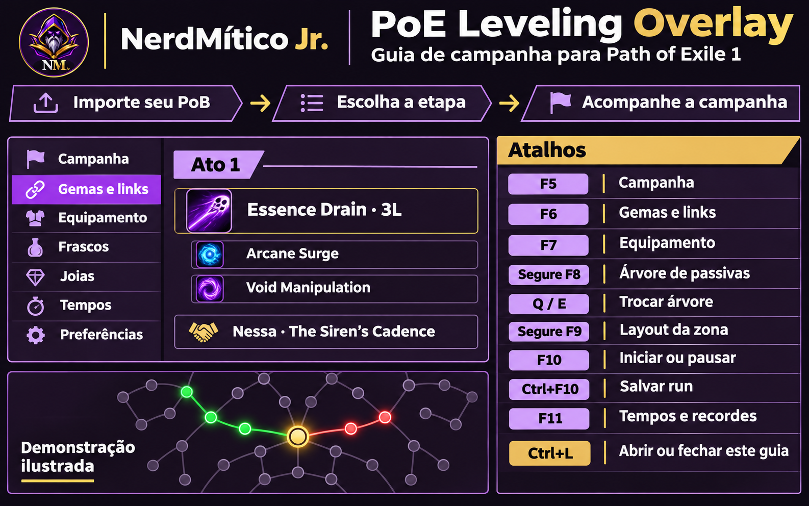

  

# PoE Leveling Overlay
### NerdMítico Jr.

Guia de campanha para **Path of Exile 1** no Windows. Importe sua build do Path of Building e consulte a rota, as gemas e a árvore de passivas durante o jogo.

[**⬇ Baixar para Windows**](https://github.com/ClaudioAlvesJunior/poe-leveling-overlay/releases/latest/download/NerdMiticoJr-PoE-Leveling-Overlay.zip) · [**Wiki**](docs/README.md) · [**Versões**](CHANGELOG.md) · [**Apoiar**](APOIAR.md) · [**Reportar problema**](https://github.com/ClaudioAlvesJunior/poe-leveling-overlay/issues/new)

## Comece a jogar

1. Instale o [AutoHotkey 1.1 de 64 bits](https://www.autohotkey.com/download/1.1/) e extraia o [ZIP da versão mais recente](https://github.com/ClaudioAlvesJunior/poe-leveling-overlay/releases/latest).
2. Abra o Path of Exile 1 em modo janela sem bordas e execute `Exile UI.ahk` na pasta extraída.
3. O guia aparece sobre o jogo. Pressione **F5** para abrir o painel e clique em **Importar PoB** para ver as recompensas, compras e links da sua build.
4. Pressione **Ctrl+L** para consultar os atalhos dentro do jogo.

## O que você pode acompanhar

| Recurso | Durante a campanha |
| --- | --- |
| **Rota e segundo personagem** | Veja o próximo passo por zona e pule os desvios exclusivos de início de liga. |
| **Gemas e links** | Confira as trocas por ato, recompensas, vendedores e preços conhecidos. |
| **Equipamento, frascos e joias** | Organize os modificadores por prioridade e consulte os encaixes da árvore. |
| **Árvore e layouts** | Segure **F8** para ver a árvore planejada e **F9** para ver as referências da zona. |
| **Tempos e recordes** | Compare os tempos por zona e salve suas melhores campanhas. |

Ver infográfico de atalhos

Projeto independente mantido por **NerdMítico Jr.** [Créditos e licenças](CREDITOS.md) · [Desenvolvimento](docs/DESENVOLVIMENTO.md)
